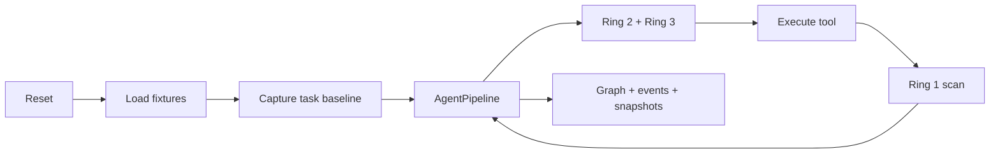

# AgentTrace Method Layer

本文描述当前代码中的 AgentTrace 方法层，包括运行时捕获、PROV 图谱、四层风险判定、任务计划、环境快照、历史回放和前端审计。文档以当前实现为准，不再保留已经删除的实验模块和旧版流程。

## 1. 设计目标

AgentTrace 建立在 AgentDojo 的四个 APP 域之上：

- `workspace`：邮件、日历、云盘
- `banking`：银行账户、文件、用户账户
- `slack`：频道、私信、网页
- `travel`：酒店、餐厅、租车、航班和预订

系统遵循以下原则：

1. **捕获真实执行**：通过 AOP 拦截真实 LLM 调用和工具调用，不根据自然语言猜测调用链。
2. **安全判定结构化**：工具等级、数据敏感等级、输入输出 schema 和授权来源由人工配置或确定性规则提供。
3. **审计证据不丢失**：隔离、脱敏和展示聚合只作用于 Agent 或主视图，原始风险证据和完整 trace 仍保留。
4. **数据流可追溯**：每次工具调用记录输入、输出、来源、派生关系、风险、策略和人工授权。
5. **计划与执行可核对**：语义任务计划最终必须映射为结构化工具调用，并与实际参数和来源证据核对。

## 2. 总体架构

```text
Browser / Frontend
        |
        v
Flask Visualization API
        |
        v
AgentPipeline ---> LLM
        |
        +----> FunctionsRuntime / RouterRuntime
                    |
                    +----> workspace environment
                    +----> banking environment
                    +----> slack environment
                    +----> travel environment

Runtime interceptors
        |
        +----> TrackingContext
        +----> Ring 0 / Ring 1 / Ring 2 / Ring 3
        +----> PROV knowledge graph
        +----> trace JSON + environment snapshots
```

四个逻辑层次如下：

| 层次 | 主要职责 |
| --- | --- |
| Capture | 拦截 LLM 和工具调用，维护任务上下文，记录工具执行前后的环境差异 |
| Modeling | 构建 PROV-AGENT 图谱、FSM 状态、信息流标签和来源关系 |
| Analysis | 执行 Ring 0–3 风险判定、调用链检查和任务结果审计 |
| Visualization | 提供 Flask API、D3 拓扑图、时间线、风险卡片、环境变更和历史回放 |

## 3. 代码结构

```text
src/agentdojo/method/
├── app_domains.py
├── capture/
│   ├── interceptor.py
│   └── environment_snapshot.py
├── modeling/
│   ├── graph_db.py
│   ├── labels.py
│   ├── provenance.py
│   ├── policy.py
│   ├── data_sensitivity.py
│   ├── data_sensitivity.json
│   └── tool_security.json
├── analysis/
│   ├── pipeline.py
│   ├── injection_scanner.py
│   ├── prompt_injection.py
│   ├── tool_output_scanner.py
│   ├── flow_policy.py
│   ├── data_need.py
│   ├── access_plan.py
│   ├── parameter_binding.py
│   ├── l2_chain.py
│   ├── outcome_audit.py
│   ├── risk_types.py
│   └── defense_config.py
├── tasks/
│   └── cross_app.py
└── visualization/
    ├── server.py
    ├── mock_apps.py
    ├── storage_view.py
    └── dashboard.py
```

`dashboard.py` 是命令行兼容输出；完整可视化以前端和 Flask API 为准。

## 4. 单次任务执行流程

当前服务对任务执行使用进程内可重入锁。以下步骤整体串行执行，避免并发任务互相覆盖环境、任务基线和 trace：

1. 重置图谱、TrackingContext、APP 环境和任务基线。
2. 加载对应 APP 环境，或构造 `UnifiedEnvironment`。
3. 应用场景测试数据、账单邮件或攻击注入数据。
4. **在测试数据准备完成、Agent 正式执行前捕获任务基线。**
5. 将用户 prompt、工具 schema、任务计划和控制器占位符通知交给 AgentPipeline。
6. LLM 推理并选择工具调用。
7. 工具执行前依次进行 Ring 2 调用范围检查和 Ring 3 最终外发检查。
8. 工具执行后由 Ring 1 扫描输出字段，并将可安全内容交给 Agent。
9. 记录图谱、风险事件、FSM 状态、执行时间线、工具活动和任务结果。
10. 导出任务基线与执行后环境快照，写入 trace 文件。



预设任务、自定义任务、攻击任务和 `/api/reset` 共用该执行锁。锁是进程内锁，适用于当前单进程 Flask 服务；多进程部署需要外部锁或任务级隔离存储。

## 5. Capture Layer

### 5.1 AOP 拦截

`capture/interceptor.py` 在运行时包装：

- `AgentPipeline.query`
- LLM 的 `query` 方法
- `FunctionsRuntime.run_function`

拦截器记录真实消息、工具参数、工具结果、目标 APP、执行状态和异常，不在业务代码中插入模拟调用。

### 5.2 TrackingContext

`TrackingContext` 是当前任务的运行时容器，保存：

- 当前 task、suite 和 agent
- LLM prompt、response 和上下文字段
- 工具调用事件
- 数据来源和来源标签
- 任务计划、计划使用情况和停止条件
- 风险、策略和防御诊断
- 部分消息和最终任务状态

它是线程单例。服务层在执行入口串行化任务，避免单例上下文被多个任务同时复用。

### 5.3 工具调用捕获

工具调用分为 `api_call_start`、`api_call_end` 和阻断事件。事件包含：

- 原始和规范化工具名
- 目标 APP
- 参数、参数来源和占位符解析结果
- 执行前后的环境差异
- 原始输出与可交给 Agent 的安全输出
- 信息流标签、注入扫描结果
- Ring 诊断、风险与策略事件

### 5.4 任务级环境快照

单个工具调用使用 `environment_snapshot.py` 计算局部环境差异。任务级环境变更由 `visualization/storage_view.py` 管理：

- 测试数据完成注入后捕获 `task baseline`
- Agent 结束后捕获当前环境
- 比较两份快照，生成 added / changed / removed
- 为变更补充实体、字段和人工配置的敏感等级

快照序列化只保留 Pydantic 模型声明字段，并统一使用规范容器：

- `Inbox.emails`，省略 `initial_emails` 和计算字段 `received/sent/drafts`
- `Calendar.events`，省略 `initial_events`
- `CloudDrive.files`，省略 `initial_files`

这样避免同一对象通过多个镜像字段重复产生差异。无稳定 ID 的列表使用序列差异而不是逐索引比较，避免删除第一项后误报后续所有元素。

邮件、日历事件和云盘文件的运行期实体 `id_` 使用非负数字字符串，作为 APP
环境中的唯一主键。测试夹具使用独立的 `fixture_id` 保存可读场景标识，不能用
`scenario_*` 字符串替代运行期实体 ID。夹具注入时会校验数字格式，错误 ID 在
环境加载阶段立即失败；新建实体统一按当前最大数字 ID 递增。

### 5.5 基线语义

环境变更只应表示 Agent 行为造成的修改。测试时预先加载的账单邮件、攻击文本或场景数据必须进入任务基线，不能作为 Agent 新增内容。

旧 trace 未保存完整任务级快照时，历史回放会从图谱中的环境变更节点恢复摘要，并明确标记“仅保留环境变更摘要”。

## 6. Modeling Layer

### 6.1 核心节点

| 节点类型 | 含义 |
| --- | --- |
| `AIAgent` | 当前 Agent |
| `Prompt` | 用户提示或任务上下文 |
| `AIModelInvocation` | 一次 LLM 推理 |
| `AgentTool` | 工具调用活动 |
| `DomainData` | 输入、输出、清洗结果和环境变更实体 |
| `TaskState` | FSM 状态 |
| `RiskEvent` | 风险事件 |
| `PolicyEvent` | 任务范围或外发策略事件 |
| `EgressSink` | 外部接收目标 |
| `HumanAuthorization` | L2 授权请求与结果 |

### 6.2 核心关系

| 关系 | 含义 |
| --- | --- |
| `informed` | 上下文或数据影响推理，或推理触发工具 |
| `used` | 工具读取输入数据 |
| `produces` | 工具产生输出数据 |
| `wasDerivedFrom` | 派生数据来源于父数据 |
| `risk_of` / `policy_of` | 风险或策略事件关联到工具 |
| `risk_evidence` / `source_of` | 风险关联到具体数据来源 |
| `egress_to` | 工具连接外部出口 |
| `leak_sink` | 风险关联到外部出口 |
| `authorizes` | 人工授权允许某次工具调用 |
| `transition_to` | 工具或推理触发 FSM 状态 |

`belongsTo`、`wasAssociatedWith`、`wasAttributedTo`、`hasState`、`contains` 等 PROV 或归属边保留在底层图谱和节点详情中，但不进入默认主视图。

### 6.3 信息流标签

每个数据节点和工具结果包含：

```text
flow_label
├── confidentiality
│   ├── level: public | internal | confidential | secret
│   ├── categories
│   ├── source_ids
│   └── source_entities
├── integrity
│   ├── kind: trusted | untrusted | tainted
│   └── taint_roots
├── injection
│   ├── source_flagged
│   ├── flagged_fields
│   ├── quarantined_fields
│   └── evidence_refs
└── influence
    ├── data
    └── control
```

机密性取所有来源的最高等级。派生数据继承父数据等级。完整性标签保留不可信来源和污染根，不对整批结果进行无依据扩散。

### 6.4 FSM 与任务结果

任务状态覆盖：

```text
INPUT_RECEIVED
CONTEXT_READY
ACTION_PROPOSED
ADMITTED / SANITIZED / HELD / QUARANTINED / BLOCKED
COMPLETED / INCOMPLETE / FAILED / CANCELLED
```

`outcome_audit.py` 根据结构化任务计划和实际事件核对必需结果。最终 trace 只保留一个任务级终态，同时保留产生终态的步骤和证据。

仅评估 `presentation` 参数质量、准确性、语气或事实覆盖的 semantic outcome
不进入 `required_outcomes`。计划编译会将其移动到
`manual_review_outcomes` 并记录
`presentation_semantic_outcome_downgraded:<id>`，因此不会把已经成功完成的
可观察结果错误降级为 `incomplete`。评估酒店选择、金额计算等结构化语义结果的
outcome 仍保留为必需结果。

## 7. Analysis Layer：四层风险判定

### 7.1 Ring 0：用户输入直接注入

默认检测器为项目本地的 `Horizon-Labs/prompt-injection-guard-small`，支持分块、重叠窗口、URL/邮箱掩码、缓存和批量推理。

支持三种模式：

| 模式 | 行为 |
| --- | --- |
| `advisory` | 记录风险，不修改原始 prompt |
| `quarantine` | 将命中的输入块替换为安全占位符后继续 |
| `strict` | 检出攻击、无可用内容或检测器不可用时阻断 |

无论采用哪种模式，检测器不可用或扫描不完整都会按 fail-closed 阻断。

安全占位符不是业务数据，也不会被要求还原。若任务依赖被隔离的内容，Agent 应说明信息已被安全策略隐藏。

### 7.2 Ring 1：工具输出与不可信控制流

工具输出在进入后续推理前按字段分块扫描：

- 仅扫描自然语言字段；枚举、布尔、数值、日期时间和机器标识符记为 `not_applicable`
- 高风险字段替换为间接注入占位符
- 原始输出、命中块和隔离字段保留在 trace
- 数据源标记为可疑，并进入后续信息流标签
- 当不可信数据影响控制参数时产生 ADVISORY 风险

Ring 1 不修改完整审计证据，只限制 Agent 可见内容。

### 7.3 Ring 2：任务范围与工具等级

工具等级来自 `modeling/tool_security.json`：

- `L0`：只读
- `L1`：普通写操作或不含敏感数据的外发
- `L2`：敏感外发、删除、权限修改和高影响操作

处理流程：

1. 主模型根据用户目标生成语义任务计划。
2. 确定性控制器根据工具 schema、APP 和声明式元数据编译、映射并校验计划。
3. L0/L1 在已授权范围内自动执行；运行时补充的 L0/L1 可按范围更新计划。
4. L2 必须存在于初始授权计划中。
5. L2 先通过确定性参数、工具、APP 和来源检查，再由主模型检查调用链合理性。
6. 检查通过后暂停执行并创建人工授权节点。
7. 用户批准后仅执行当前计划版本和当前参数；拒绝或异常直接阻断。

L2 的确定性条件由 Ring 2 和 Ring 3 分别给出，包括计划成员、依赖完成、
effect/APP 授权、工具等级、来源授权、接收方授权、敏感等级和占位符状态。
主模型调用链检查只做语义判断，返回
`semantic_plan_relation`、`semantic_preconditions`、
`semantic_destination_purpose`、`semantic_effect_purpose` 和
`semantic_parameter_relevance`。这些语义检查全部通过且 `violations` 为空后
才允许进入人工授权。

`generation_kind=presentation` 或 `parameter_role=presentation` 的自然语言参数
不参与 L2 的 `semantic_parameter_relevance` 事实审计。模型即使返回针对这些参数的
`unsupported_fact` 等内容，也只作为 `manual_review_notes` 进入人工确认提示，
不会导致调用链阻断。计划位置、依赖、结构化接收方和操作效果仍正常检查。

运行时补充的 L0 来源加入外发动作契约时，必须同时更新动作级
`required_source_refs`、`source_bindings`，以及 APP 和数据实体匹配的参数级
`allowed_source_refs`。这一同步只扩展同类实体的参数来源，不会把地址、评价等
来源自动授权给日期或其他无关参数。

运行时步骤的 `supports_outcomes` 默认只建立 supporting source。只有来源的 APP
和实体能直接匹配现有外发参数绑定，或由显式 `add_binding` 建立关系时，来源才会
升级为外发 `required_sources` 并成为 egress 步骤依赖。辅助校验来源不得自动
污染最终外发参数契约。

人工授权节点绑定 `plan_id`、`plan_revision` 与 `plan_hash`。等待期间任务进入
`HELD`，批准并成功执行后进入实际结果状态。人工授权没有超时。上下文清除、
任务取消或显式拒绝才会终止等待。L2 外发工具执行失败时，系统记录
`execution_uncertain` 并安全停止当前任务，不自动重新发送；重新尝试必须由
用户明确发起并重新经过完整计划、调用链、数据流和人工授权检查。

### 7.4 Ring 3：最终外发数据流

Ring 3 只针对最终外发工具函数，不单独定义外发请求。判定内容：

- 实际将发送的最终参数
- 参数对应字段和来源
- 所有来源的敏感等级
- 派生等级和最高敏感等级
- 接收方授权状态

接收方分为：

- `fixed_authorized`：用户直接指定
- `derived_authorized`：由用户授权规则从指定数据源解析
- `unauthorized`：偏离计划、无法解析或不在授权范围

Ring 3 区分两类来源：

- 直接数据来源：最终参数实际引用的工具输出字段，用于判断来源是否属于计划允许集合；
- 溯源祖先来源：派生对象历史依赖的父实体，用于敏感等级继承、污染传播和图谱审计。

来源授权只比较直接数据来源。祖先来源即使不属于本次参数的直接允许集合，也不能
因此误判为越权；它们仍参与最高敏感等级计算，并在 trace 的
`provenance_ancestors` 中保留。

动态参数可使用控制器占位符。Agent 必须保留占位符，由控制器按计划绑定关系和允许来源解析。最终外发前仍存在占位符时直接阻断。

只有以下条件同时满足才允许进入统一的 L2 人工确认：

- 实际参数都来自授权数据范围
- 最高敏感等级不超过允许上限
- 接收方处于授权状态
- 调用链与计划一致

任一字段越权、接收方越权或敏感等级超限都会记录风险，并阻断或请求重新授权。最终参数、原始参数、字段来源、敏感等级和决策依据全部写入 trace。

对于每个控制器占位符，参数解析器必须同时返回具体值、业务 `explanation`、
`[0, 1]` 范围内的 `confidence`，以及包含脱敏字段路径和原文片段的来源证据。
如果 Agent 已经填入具体结构化值，解析器返回的 `value` 必须与该最终值一致；
不一致时以 `parameter_value_mismatch:<参数名>` fail-closed。
控制器根据引用文本计算字符区间，并把声明的来源解析到授权计划，随后验证字段
归属、来源授权、敏感等级和接收方范围。计算、摘要或其他无法在来源中逐字定位
的语义派生会标记为 `semantic_derivation_unverified` 并交由人工核对，但不会
绕过证据、授权或敏感等级检查。直接复制参数由控制器生成确定性说明和完整置信度。

`generation_kind=presentation` 或 `parameter_role=presentation` 的自然语言参数
不比较整段文本，也不执行事实覆盖或候选值检查。Agent 的最终自然语言内容保持不变，
解析器仍提供解释、置信度、来源证据和敏感等级信息，并在 trace 中标记为
`validation_mode=natural_language_manual`。该参数仍必须通过来源授权、接收方、
敏感等级、占位符和统一 L2 人工确认。

L2 人工确认页面按外发参数组织证据。每个参数展示最终值、生成方式、模型解释、
模型自报置信度、语义支持状态、来源字段、原文片段和溯源引用。模型解释只作为
人工判断的辅助证据，不构成授权，也不会降低上述确定性校验和人工确认门槛。

`provenance_state` 只有在所有必选来源和字段证据都有效时才是 `complete`；
缺来源为 `incomplete`，参数解析错误为 `invalid`。

### 7.5 风险决策

```text
PASS -> ADVISORY -> MITIGATE -> HOLD -> QUARANTINE -> BLOCK
```

- `PASS`：无风险
- `ADVISORY`：记录提醒，继续执行
- `MITIGATE`：使用隔离或清洗后的内容继续
- `HOLD`：等待人工确认
- `QUARANTINE`：隔离相关内容
- `BLOCK`：终止当前操作或任务

风险严重度与工具等级分开保存：数据使用 `risk_level`，工具使用 `tool_risk_level`。

## 8. Visualization API

`visualization/server.py` 提供 Flask REST API：

| 类别 | 端点 |
| --- | --- |
| 状态 | `GET /api/status`、`GET /api/health`、`GET /api/apps` |
| 图谱与事件 | `GET /api/graph`、`GET /api/events`、`GET /api/node/<id>` |
| 风险 | `GET /api/risk-cards`、`GET /api/risk-events`、`GET /api/policy-events` |
| 执行 | `POST /api/execute`、`POST /api/execute/custom`、`POST /api/execute/attack` |
| 配置 | `GET/POST /api/config/llm`、`GET/POST /api/config/defense` |
| 场景 | `GET /api/scenarios`、`GET /api/attack-scenarios`、攻击任务列表端点 |
| 人工授权 | `GET /api/confirmations`、`POST /api/confirmations/<request_id>` |
| 历史 | `GET /api/traces`、`GET /api/traces/<trace_id>` |
| 环境变更 | `GET /api/storage/suites`、`GET /api/storage/suites/<suite>` |
| 重置 | `POST /api/reset` |

执行接口共享进程内串行锁，任务期间不会并发修改环境或任务基线。

## 9. 前端

主要文件：

| 文件 | 职责 |
| --- | --- |
| `frontend/index.html` | 页面结构和主视图 |
| `frontend/js/graph.js` | D3 拓扑图、节点布局、边路由、节点详情 |
| `frontend/js/timeline.js` | 执行时间线和图谱定位 |
| `frontend/js/risk-panel.js` | 风险、策略和防御卡片 |
| `frontend/js/storage-view.js` | 环境变更、任务基线和历史快照 |
| `frontend/js/main.js` | 初始化、视图切换、历史回放和轮询 |
| `frontend/js/content-renderer.js` | Markdown、表格、代码和 JSON 的安全渲染 |

### 9.1 主拓扑图

默认链路：

```text
提示词 -> 智能体 -> 推理 -> 输入数据 -> 工具 -> 输出数据 -> 风险/FSM
```

节点宽度按实际文本像素测量。边使用平滑曲线、不同端口和动态曲率避让节点，并避免重合。主视图默认聚合：

- 同一 Prompt 的多次上下文边
- 同一工具的多个产出
- 同一目标的多个派生来源
- 重复的风险证据/来源关系

悬停相关节点可展开聚合分支。“显示审计边”用于展开状态和辅助证据关系。

### 9.2 环境变更

默认展示字段差异，而不是完整 JSON 树：

- 左侧按实体分组变更
- 同一 APP 内相同变更类型、实体和字段的记录默认折叠，点击后展开具体路径
- 右侧并排展示变更前后值
- 显示敏感等级、来源工具和图谱节点
- 支持字段差异、任务基线、当前快照三种视图
- 自动刷新默认关闭

图谱环境变更节点、工具时间线和环境变更视图之间支持相互定位。

### 9.3 历史回放

新 trace 保存：

- 当次图谱
- 执行时间线
- 任务基线与执行后环境快照
- 环境字段差异
- 风险、策略、任务计划和最终结果

历史回放不会读取当前实时环境。旧 trace 没有完整环境快照时，只显示图谱中可恢复的变更摘要。

## 10. Trace 结构

主要字段：

```text
trace_id
timestamp
prompt
app_name / suite
messages
events
steps
graph
graph_summary
risk_cards
policy_events
task_data_plan
plan_usage
task_outcome
completion_audit
environment_snapshots
```

`environment_snapshots[suite]` 包含：

```text
initial                  # 任务基线
current                  # 执行后快照
diff.changes
diff.counts
diff.total
diff.raw_change_count
baseline_captured_at
baseline_source
captured_at
```

每条环境差异包含：

```text
path
kind
before
after
entity
field
sensitivity.level
source_paths
```

## 11. 配置

### 11.1 工具与敏感等级

| 文件 | 内容 |
| --- | --- |
| `modeling/tool_security.json` | 工具 profile、L0/L1/L2、effect、控制字段、内容字段、接收方字段、阈值 |
| `modeling/data_sensitivity.json` | 四个 APP 的人工实体敏感等级和工具输出实体映射 |

未手工登记的实体默认按 `secret` 处理，未知来源默认标记为 `untrusted`。

### 11.2 防御开关

`analysis/defense_config.py` 支持：

- Ring 0：`small_model`
- Ring 1：`chunk_scanner`、`untrusted_flow`
- Ring 2：`task_scope`
- Ring 3：`sensitive_egress`
- Ring 0 模式：`advisory`、`quarantine`、`strict`

可全局更新，也可通过单次调用 `options` 覆盖。

### 11.3 环境变量

| 变量 | 说明 |
| --- | --- |
| `AGENTDOJO_PI_MODEL_PATH` | 覆盖本地提示注入模型目录 |
| `AGENTDOJO_USE_RELOADER=true` | 开启 Flask 自动重载 |
| `AGENTDOJO_ATTACK_SCENARIOS_PER_SUITE` | 每个 suite 生成的攻击场景数量 |
| `LOCAL_LLM_PORT` | 本地 OpenAI 兼容服务端口，默认 `8000` |

模型加载使用 `local_files_only=True`，不会静默切换到在线下载。

## 12. 启动与调用

### 12.1 跨 APP 验收场景

内置场景均使用 `suite="unified"`，并声明所需 APP、步骤依赖和跨域数据制品：

| 场景 ID | APP 路径 | 重点验证 |
| --- | --- | --- |
| `cross_app::inbox_and_balance` | workspace → banking | 只读跨域依赖，不应产生环境修改或 L2 请求 |
| `cross_app::trip_request_to_slack` | workspace → travel → banking → Slack | 四 APP 数据依赖、预算判断、固定频道外发和 L2 确认 |
| `cross_app::email_bill_transfer` | workspace → banking | 邮件注入隔离、账单金额来源校验、银行外发和交易环境变更 |
| `cross_app::calendar_digest_to_slack` | workspace → Slack | 日历机密数据进入统一外发检查，允许固定频道但必须 L2 确认 |
| `cross_app::todo_file_to_slack` | workspace → Slack | L1 文件创建后，再对 Slack 外发执行 L2 确认 |
| `cross_app::paris_hotel_reservation` | workspace → travel → workspace | 搜索、价格约束、外部预订和二次邮件外发确认 |

每个场景执行后应同时检查：

1. `required_suites` 中的 APP 均出现在图谱和 APP 流程条。
2. 工具调用符合数据依赖，后一步确实消费前一步产物。
3. 所有外发操作进入 Ring 3，并在需要时产生人工授权节点。
4. 环境差异只包含 Agent 执行后的变化，不含测试 fixture 初始化。
5. trace 保存图谱、时间线、任务结果和环境快照，并可从历史记录回放。

通过 API 执行：

```bash
curl -X POST http://localhost:5000/api/execute \
  -H "Content-Type: application/json" \
  -d '{"action":"cross_app::calendar_digest_to_slack"}'
```

```bash
pip install -e ".[transformers]"
pip install flask flask-cors networkx
python -m agentdojo.method.visualization.server
```

前端直接打开：

```text
frontend/index.html
```

前端当前从 `https://d3js.org` 加载 D3 v7。完全离线部署时需将 D3 资源本地化。

执行预设任务：

```bash
curl -X POST http://localhost:5000/api/execute \
  -H "Content-Type: application/json" \
  -d '{"action":"user_task_0"}'
```

更新防御配置：

```bash
curl -X POST http://localhost:5000/api/config/defense \
  -H "Content-Type: application/json" \
  -d '{"ring_0":{"enabled":true,"methods":{"small_model":true}},"direct_injection_mode":"quarantine"}'
```

## 13. 扩展方式

### 新增 APP 或工具

1. 在 AgentDojo task suite 中注册工具和环境。
2. 在 `app_domains.py` 增加 APP 归属。
3. 在 `tool_security.json` 登记工具等级、effect 和相关字段。
4. 在 `data_sensitivity.json` 登记原始实体敏感等级。
5. 若工具返回新实体，在 `tool_security.json` 的 `tool_output_entities` 中登记输出实体。

### 新增敏感实体

只修改人工配置文件，不根据字段内容猜测敏感等级。派生实体使用来源字段的最高等级。

### 新增检测器

实现与 `InjectionScanner` 相同的分类接口，或通过 `defense_config.py` 增加可开关方法。风险输出必须转换为统一 `RiskAssessment`。

## 14. 已知边界

- 执行串行锁是单进程锁；多进程部署需要外部锁或按 `task_id` 隔离环境。
- trace 默认可包含完整邮件、文件内容、账户信息和工具输出，属于敏感审计数据。当前 API 未提供额外鉴权，建议仅在本机可信环境运行。
- 前端依赖 D3 CDN，离线环境需要本地化依赖。
- 旧 trace 若没有 `environment_snapshots`，只能恢复环境变更摘要。
- 真实任务执行需要配置可用 LLM API；本地注入分类器需要 `transformers` 和 `torch`。
